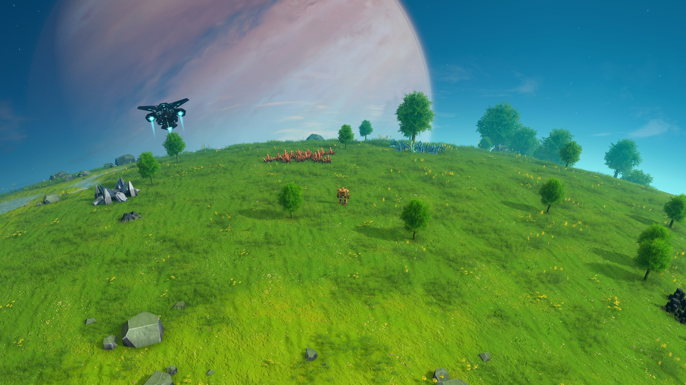

# 多样的生物群系 · Diverse Biomes

[English](README.md) · 2.4.0 预览版 · 原版可用，GS2 可选

[下载 2.4.0](https://github.com/cmx00/DiverseBiomes/releases/tag/v2.4.0)

多样的生物群系是《戴森球计划》的植被模组。植物的密度和大小会随地形变化，同一颗星球上可以有草地、密林和稀疏的山坡；不同星球主题分别调整。

建厂时，只清理与建筑实际重叠的植物，尽量保留工厂旁边的树林和草地。

**不需要 Galactic Scale 或 BetterSolarSystem。** 可以直接用于原版生成的星区；安装 GS2 后，会自动启用额外主题适配。



## 地形与植被

“群落”是一片区域中植物的组合、密度和大小。分布主要依据水岸、海拔、坡度和局部湿润程度：

- 水岸与湿润低地的植被更连贯。
- 草地、林缘与密林的密度不同，林间也会留有空地。
- 陡坡、山脊和寒地采用更稀疏或更低矮的组合。
- 裸岩、冰雪和荒漠星球统一调整已有地表装饰，不凭空长出森林。

模组使用星球主题已有的植物模型。没有植物的主题只调整岩石等装饰，不添加树木，也不改变地形。

## 星球主题

原版的地中海、海洋丛林、红石、草原、樱林、稀树草原和潘多拉沼泽各有独立规则。使用 GS2 时，也支持巨冠森林、赤色森林等额外主题。

| 星球主题 | 主要变化 |
| --- | --- |
| 草原、稀树草原 | 连片草地、散落树木与林地斑块交替，保留较多开阔区域 |
| 地中海、海洋丛林 | 水岸林带、湿润低地、林间空地与高地植被相互衔接 |
| 红石 | 草地与耐旱植被形成斑块，岩坡更稀疏 |
| 樱林 | 花谷、密林与较疏的坡地有明显区别 |
| 潘多拉沼泽 | 湿地植物与异星林地混合 |
| GS2 森林主题 | 分别调整密林、林间空地和坡地植被 |

共支持十二个有机主题，每个主题有八种局部群落组合，其中部分主题来自 GS2。寒地、风剪区、岩坡和裸地共用一套过渡规则。相邻群落的密度和植物尺寸会逐渐变化，边界不会整齐切成一条线。

## 建造与清理

铺设建筑通常会清理附近植物。这里按建筑的实际形状判断重叠，缩小不必要的清理范围。铺地和手动采集照常使用，植物尺寸有上限，避免影响通行。

## GS2 适配

安装 GS2 时，还会轻微调整部分固体矿团的位置，使其更贴合局部地形。它不增加矿量，也不搬动旧档中已经生成的矿点。**原版模式只提供植被与建造保护，不启用矿团位置调整。**


*截图同时使用 BetterSolarSystem。木星背景和太阳系布局由该模组提供，单独安装生物群系不会生成这套太阳系。*

## 安装

需要 **BepInEx 和 DSPModSave**。DSPModSave 用于保存每个存档的群落设置。Galactic Scale 和 BetterSolarSystem 都是可选项。

可以使用原版星区生成器，也可以使用 GS2 生成器。手动安装时，先关闭游戏，把包内两个文件放在同一目录：

```text
BepInEx/plugins/DiverseBiomes/DiverseBiomes.dll
BepInEx/plugins/DiverseBiomes/DiverseBiomes.GalacticScale.dll
```

第二个文件是 GS2 适配器，只有安装 GS2 时才加载。

## 存档与兼容

**完整新群落需要在安装后新建存档。** 群落与植物尺寸设置会随存档保存。修改配置后，已有星区继续使用原设置，新建星区使用新设置。

已有原版存档继续使用原来的植被分布。旧 LW1–LW3 存档不会转换到新群落采样器；已有工厂不会复活已清理的植物，未开发或重新生成的地表可能使用基础植被。如果需要历史地表外观完全一致，请保留原版本。

备份或移动存档时，请一起保留 DSPModSave 的 `.moddsv` 附属文件。GS2 存档还需要 GS2 和对应的 `.gs2` 文件；本模组不会将 GS2 存档转换为原版星区。

配置文件沿用 `BepInEx/config/cmx.LivingWorlds.cfg`，以读取旧设置。换用本包前停用旧 LivingWorlds、GiantPlants 和 VegetationProtection，避免重复修改。

无 GS2 加载、原版主题识别、设置保存与恢复、切换存档和可选适配器的针对性检查已通过。完整游戏内的画面、建造和保存后重载仍需验证，因此当前以预览版发布。

编译见 [BUILDING.md](BUILDING.md)。反馈问题时请附主题、行星半径、种子、是否使用 GS2 和截图。源码采用 [MIT 许可](LICENSE)，代码来源与图片说明见 [NOTICE.md](NOTICE.md)。
